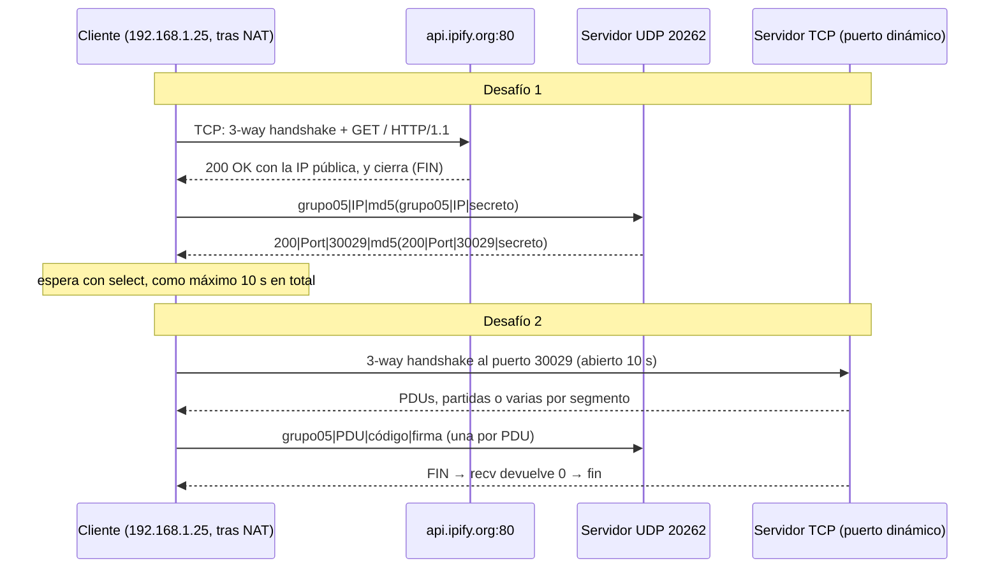

# Visión general: qué hace el programa de punta a punta

## En una frase

El cliente le pregunta su IP pública a ipify y se autentica por UDP con una firma MD5. El
servidor le contesta un puerto, el cliente se conecta ahí por TCP, separa las PDUs que le
llegan, las valida y reporta cada una firmada por UDP.

## La secuencia completa



(GitHub y Obsidian dibujan este diagrama. Si no se ve, la tabla de abajo cuenta lo mismo.)

| # | Quién → quién | Transporte | Qué viaja |
|---|---|---|---|
| 1 | cliente → ipify | TCP 80 | `GET / HTTP/1.1` escrito a mano |
| 2 | ipify → cliente | TCP 80 | `HTTP/1.1 200 OK` + la IP en el cuerpo |
| 3 | cliente → servidor | UDP 20262 | `grupo05\|<IP>\|<firma>` |
| 4 | servidor → cliente | UDP | `200\|Port\|<puerto>\|<firma>` (o `400`/`401`) |
| 5 | cliente → servidor | TCP `<puerto>` | 3-way handshake |
| 6 | servidor → cliente | TCP `<puerto>` | PDUs `<timestamp>&<mensaje>\r\n` |
| 7 | cliente → servidor | UDP 20262 | un reporte firmado por cada PDU |
| 8 | servidor → cliente | TCP | FIN: se cierra la conexión |

## El `main` (`src/cliente.c`)

El `main` no tiene lógica propia: solo llama a los pasos en orden y corta si alguno falla
(termina con `return 1`). Cada paso es una función en su propio archivo.

```c
./cliente <usuario> <secreto> <ip_servidor>
```

1. **Argumentos.** Si no son exactamente 3, muestra el uso y sale. El usuario y el secreto van
   por línea de comandos, así no quedan escritos en el código ni en el repositorio.
2. **IP pública:** `consulta_ip(respuesta, sizeof(respuesta))` deja la respuesta HTTP en un
   buffer de 3000 bytes, y `obtener_ip(respuesta, ip)` saca la IP de ahí.
3. **Pedido firmado:** `armar_pedido(usuario, ip, secreto, pedido, sizeof(pedido))`.
4. **Envío por UDP:** `s = enviar_pedido(ip_servidor, pedido)` devuelve el socket UDP **abierto**.
5. **Respuesta:** `recibir_puerto(s, ip_servidor, secreto, &puerto)` espera hasta 10 s y deja
   el puerto en `puerto`.
6. **Conexión TCP:** `s_tcp = conectar_tcp(ip_servidor, puerto)`.
7. **PDUs:** `enviados = procesar_pdus(s_tcp, s, ip_servidor, usuario, secreto)` lee, valida y
   reporta hasta que el servidor cierra. Usa el **mismo** socket UDP `s` para los reportes.
8. Cierra los dos sockets y termina con `return 0`.

### Dos convenciones que se repiten en todo el código

- **Quien llama reserva el buffer y la función lo llena.** Por ejemplo, el `main` declara
  `char ip[INET4_ADDRSTRLEN]` y se lo pasa a `obtener_ip`. Nunca se devuelve un puntero a una
  variable local, porque esa memoria desaparece cuando la función termina.
- **Las funciones devuelven 0 si salió bien y 1 (o -1) si hubo error**, y el error ya se
  muestra adentro con `fprintf(stderr, ...)`. Por eso el `main` solo chequea el resultado y
  sale.

## Archivos y funciones

| Archivo | Funciones | Qué resuelve |
|---|---|---|
| `cliente.c` | `main` | El orden de los pasos |
| `ip_publica.c` / `.h` | `consulta_ip`, `obtener_ip` | IP pública con HTTP sobre TCP |
| `md5.c` / `.h` | `md5_hex` (+ `procesar_bloque`, `rotar_izq`, internas) | El hash MD5 |
| `autenticacion.c` / `.h` | `armar_pedido`, `enviar_pedido`, `esperar_respuesta`, `separar_campos`, `verificar_respuesta`, `recibir_puerto`, `enviar_al_servidor` | Todo lo que es UDP |
| `conexion_tcp.c` / `.h` | `conectar_tcp`, `procesar_pdus` | La conexión TCP y el loop del desafío 2 |
| `pdu.c` / `.h` | `acumulador_iniciar`, `acumulador_agregar`, `extraer_pdu`, `validar_pdu`, `armar_reporte` | Framing, validación y armado de reportes, sin red |
| `test_*.c` | — | Pruebas sin red de MD5, autenticación y PDUs |

Cada `.c` incluye su propio `.h`. Así, si la firma de una función en el `.c` no coincide con
la declarada en el `.h`, el compilador da error.

## Salida esperada de una corrida

```
IP pública: 190.225.36.143
Pedido: grupo05|190.225.36.143|<firma>
Pedido enviado a 167.114.129.206
Autenticado. Puerto TCP asignado: 30028
Conectado por TCP a 167.114.129.206:30028
[200] grupo05|1794669473&Primer mensaje|200|<firma>
...
[405] 17x0000000&Mensaje | invalido  -> no se envia (tiene '|')
...
Conexion TCP cerrada por el servidor. Reportes enviados: 9
```
