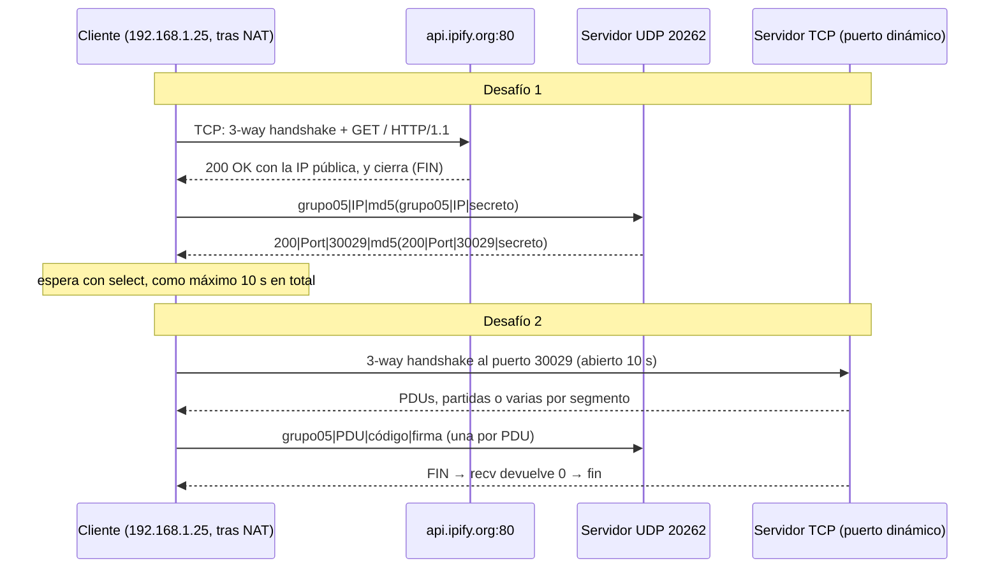

# Visión general: qué hace el programa de punta a punta

## En una frase

El cliente le pregunta su IP pública a ipify y se autentica por UDP con una firma MD5. El
servidor le contesta un puerto, el cliente se conecta ahí por TCP, separa las PDUs que le
llegan, las valida y reporta cada una firmada por UDP.

Usa los dos transportes porque la consigna fija uno para cada tramo: **TCP** para pedir la IP
(HTTP corre sobre TCP) y para recibir las PDUs (un flujo que tiene que llegar completo y en
orden), y **UDP** para autenticarse y para mandar los reportes (mensajes cortos, un datagrama
cada uno). Lo que une los dos mundos es el puerto: el servidor nos lo da por UDP y nosotros nos
conectamos ahí por TCP.

## La secuencia completa



(GitHub y Obsidian dibujan este diagrama. Si no se ve, la tabla de abajo cuenta lo mismo.)

| # | Quién → quién | Transporte | Qué viaja |
|---|---|---|---|
| 1 | cliente → ipify | TCP 80 | `GET / HTTP/1.1` escrito a mano |
| 2 | ipify → cliente | TCP 80 | `HTTP/1.1 200 OK` + la IP en el cuerpo |
| 3 | cliente → servidor | UDP 20262 | `grupo05\|<IP>\|<firma>` |
| 4 | servidor → cliente | UDP | `200\|Port\|<puerto>\|<firma>` (o `400`/`401`) |
| 5 | cliente → servidor | TCP `<puerto>` | 3-way handshake |
| 6 | servidor → cliente | TCP `<puerto>` | PDUs `<timestamp>&<mensaje>\r\n` |
| 7 | cliente → servidor | UDP 20262 | un reporte firmado por cada PDU |
| 8 | servidor → cliente | TCP | FIN: se cierra la conexión |

## El `main` (`src/cliente.c`)

El `main` no tiene lógica propia: solo llama a los pasos en orden y corta si alguno falla
(termina con `return 1`). Cada paso es una función en su propio archivo. Se corre así:

```sh
./cliente <usuario> <secreto> <ip_servidor>
```

Abajo está el archivo completo, línea por línea. Conviene leerlo con `src/cliente.c` abierto al
lado.

### Líneas 1 a 5: includes

```c
#include <stdio.h>
#include <unistd.h>
#include "ip_publica.h"
#include "autenticacion.h"
#include "conexion_tcp.h"
```

- **`<stdio.h>`**: `printf` y `fprintf`. **`<unistd.h>`**: `close`, para cerrar los sockets.
- **Los tres headers nuestros**: las funciones de cada paso y las constantes de tamaño
  (`INET4_ADDRSTRLEN`, `PEDIDO_LEN`). El `main` no incluye `md5.h` ni `pdu.h` porque no los usa
  directamente: los usan las funciones que llama.

### Líneas 7 a 17: las variables

```c
int main(int argc, char *argv[]) {
    char *usuario;
    char *secreto;
    char *ip_servidor;
    char respuesta[3000];
    char ip[INET4_ADDRSTRLEN];
    char pedido[PEDIDO_LEN];
    int s; // socket UDP
    int puerto;
    int s_tcp; // socket del desafío 2
    int enviados;
```

- **`main(int argc, char *argv[])`**: `argc` cuenta los argumentos de la línea de comandos
  (incluido el nombre del programa) y `argv` es el arreglo con cada uno como texto. Es el repaso
  de C del `ex01` de la clase.
- **`usuario`, `secreto`, `ip_servidor`**: punteros a los argumentos. No se copian: apuntan
  directo a los textos de `argv`.
- **`respuesta[3000]`**: donde `consulta_ip` deja la respuesta HTTP completa de ipify (mide unos
  225 bytes, así que sobra).
- **`ip[INET4_ADDRSTRLEN]`**: la IP pública como texto (16 bytes).
- **`pedido[PEDIDO_LEN]`**: el pedido firmado (256 bytes).
- **`s`**: el socket **UDP**, que se usa para la autenticación y para todos los reportes.
- **`puerto`**: el puerto TCP que nos asigna el servidor.
- **`s_tcp`**: el socket **TCP** del desafío 2.
- **`enviados`**: cuántos reportes se mandaron.
- **Todos los buffers se declaran acá** y se les pasan a las funciones: es la convención "quien
  llama reserva la memoria" (ver abajo).

### Líneas 19 a 26: los argumentos

```c
    // leemos los argumentos
    if (argc != 4) {
        fprintf(stderr, "Uso: %s <usuario> <secreto> <ip_servidor>\n", argv[0]);
        return 1;
    }
    usuario = argv[1];
    secreto = argv[2];
    ip_servidor = argv[3];
```

- **`argc != 4`**: el nombre del programa más los 3 argumentos. Si no son exactamente esos, se
  muestra cómo se usa y se sale con 1.
- **`argv[0]`** es cómo se llamó al programa (`./cliente`); se usa en el mensaje de uso.
- **`argv[1]` a `argv[3]`**: el usuario, el secreto y la IP del servidor.
- **¿Por qué por línea de comandos?** Así el usuario y el secreto **no quedan escritos en el
  código** ni en el repositorio.
- La IP del servidor va como **IP y no como nombre**, porque `recibir_puerto` compara la IP de
  origen de los datagramas con este texto.

### Líneas 28 a 33: paso 1, la IP pública

```c
    // paso 1: IP publica
    if (consulta_ip(respuesta, sizeof(respuesta)) != 0)
        return 1;
    if (obtener_ip(respuesta, ip) != 0)
        return 1;
    printf("IP pública: %s\n", ip);
```

- **`consulta_ip`** le pide la IP a ipify por HTTP y deja la respuesta en `respuesta`. Se le pasa
  **`sizeof(respuesta)`** (3000) porque adentro de la función el arreglo es solo un puntero y no
  sabe cuánto mide. Ver `04-ip_publica.md`.
- **`obtener_ip`** saca la IP del cuerpo de la respuesta y la deja en `ip`.
- **`!= 0`**: si alguna falla, el error ya se mostró adentro; el `main` solo sale con 1.

### Líneas 35 a 38: paso 2, el pedido firmado

```c
    // paso 2: armar el pedido firmado
    if (armar_pedido(usuario, ip, secreto, pedido, sizeof(pedido)) != 0)
        return 1;
    printf("Pedido: %s\n", pedido);
```

- **`armar_pedido`** deja en `pedido` el texto `<usuario>|<ip>|md5(<usuario>|<ip>|<secreto>)`.
  Ver `06-autenticacion.md`.
- Se imprime para verlo en la corrida (el pedido no contiene el secreto, solo la firma).

### Líneas 40 a 44: paso 3, mandarlo por UDP

```c
    // paso 3: mandarlo por UDP
    s = enviar_pedido(ip_servidor, pedido);
    if (s == -1)
        return 1;
    printf("Pedido enviado a %s\n", ip_servidor);
```

- **`enviar_pedido`** crea el socket UDP, manda el pedido al puerto 20262 y **devuelve el socket
  abierto**. Se guarda en `s` porque la respuesta tiene que leerse por el mismo socket (el NAT
  registró ese puerto).
- Esta función devuelve **-1** si falla (no 1), porque un socket válido puede ser cualquier
  número positivo.

### Líneas 46 a 51: paso 4, la respuesta

```c
    // paso 4: esperar la respuesta y verificarla
    if (recibir_puerto(s, ip_servidor, secreto, &puerto) != 0) {
        close(s);
        return 1;
    }
    printf("Autenticado. Puerto TCP asignado: %d\n", puerto);
```

- **`recibir_puerto`** espera como mucho 10 segundos una respuesta válida del servidor, verifica
  la firma y deja el puerto en `puerto`.
- **`&puerto`**: se pasa la **dirección** de la variable, para que la función pueda escribir el
  puerto ahí. Es la forma de "devolver" un segundo valor en C.
- **Si falla, cierra el socket UDP** antes de salir: desde este punto hay un socket abierto, y
  cada salida por error lo cierra.

### Líneas 53 a 59: desafío 2, conectarse por TCP

```c
    // desafio 2 - Paso 1: conectarnos por TCP al puerto asignado
    s_tcp = conectar_tcp(ip_servidor, puerto);
    if (s_tcp == -1) {
        close(s);
        return 1;
    }
    printf("Conectado por TCP a %s:%d\n", ip_servidor, puerto);
```

- **`conectar_tcp`** hace el 3-way handshake con el servidor, en el puerto que nos dio. Se llama
  **enseguida** después de recibirlo, porque el puerto está abierto solo 10 segundos.
- Si falla, cierra el socket UDP y sale. Ver `07-conexion_tcp.md`.

### Líneas 61 a 68: desafío 2, las PDUs

```c
    // desafio 2 - Paso 2: recibir las PDUs, validarlas y reenviarlas por UDP
    enviados = procesar_pdus(s_tcp, s, ip_servidor, usuario, secreto);
    close(s_tcp);
    if (enviados == -1) {
        close(s);
        return 1;
    }
    printf("Conexion TCP cerrada por el servidor. Reportes enviados: %d\n", enviados);
```

- **`procesar_pdus`** recibe **los dos sockets**: lee las PDUs por `s_tcp` y manda los reportes
  por `s` (el **mismo socket UDP** de la autenticación). Vuelve cuando el servidor cierra la
  conexión. Ver `07-conexion_tcp.md` y `08-pdu.md`.
- **`close(s_tcp)`** va **antes** del chequeo de error, para cerrar el socket TCP en los dos
  casos. Del lado de TCP, esto manda nuestro FIN.
- Si hubo un error, cierra también el UDP y sale con 1. Si no, muestra cuántos reportes mandó (9
  en la corrida de la captura).

### Líneas 70 a 73: el final

```c
    close(s);

    return 0;
}
```

- **`close(s)`** cierra el socket UDP. Como UDP no tiene conexión, no se manda nada por la red:
  solo se libera el descriptor.
- **`return 0`**: el programa terminó bien. El valor de retorno del `main` es el **código de
  salida** del programa (en la terminal se ve con `echo $?`): 0 = éxito, 1 = error.

### Dos convenciones que se repiten en todo el código

- **Quien llama reserva el buffer y la función lo llena.** Por ejemplo, el `main` declara
  `char ip[INET4_ADDRSTRLEN]` y se lo pasa a `obtener_ip`. Nunca se devuelve un puntero a una
  variable local, porque esa memoria desaparece cuando la función termina.
- **Las funciones devuelven 0 si salió bien y 1 (o -1) si hubo error**, y el error ya se
  muestra adentro con `fprintf(stderr, ...)`. Por eso el `main` solo chequea el resultado y
  sale.

## Archivos y funciones

| Archivo | Funciones | Qué resuelve |
|---|---|---|
| `cliente.c` | `main` | El orden de los pasos |
| `ip_publica.c` / `.h` | `consulta_ip`, `obtener_ip` | IP pública con HTTP sobre TCP |
| `md5.c` / `.h` | `md5_hex` (+ `procesar_bloque`, `rotar_izq`, internas) | El hash MD5 |
| `autenticacion.c` / `.h` | `armar_pedido`, `enviar_pedido`, `esperar_respuesta`, `separar_campos`, `verificar_respuesta`, `recibir_puerto`, `enviar_al_servidor` | Todo lo que es UDP |
| `conexion_tcp.c` / `.h` | `conectar_tcp`, `procesar_pdus` | La conexión TCP y el loop del desafío 2 |
| `pdu.c` / `.h` | `acumulador_iniciar`, `acumulador_agregar`, `extraer_pdu`, `validar_pdu`, `armar_reporte` | Framing, validación y armado de reportes, sin red |
| `test_*.c` | — | Pruebas sin red de MD5, autenticación y PDUs |

Cada `.c` incluye su propio `.h`. Así, si la firma de una función en el `.c` no coincide con
la declarada en el `.h`, el compilador da error.

## Salida esperada de una corrida

```
IP pública: 190.225.36.143
Pedido: grupo05|190.225.36.143|<firma>
Pedido enviado a 167.114.129.206
Autenticado. Puerto TCP asignado: 30028
Conectado por TCP a 167.114.129.206:30028
[200] grupo05|1794669473&Primer mensaje|200|<firma>
...
[405] 17x0000000&Mensaje | invalido  -> no se envia (tiene '|')
...
Conexion TCP cerrada por el servidor. Reportes enviados: 9
```
